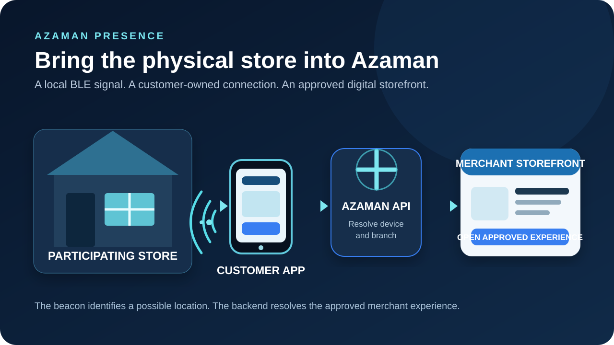
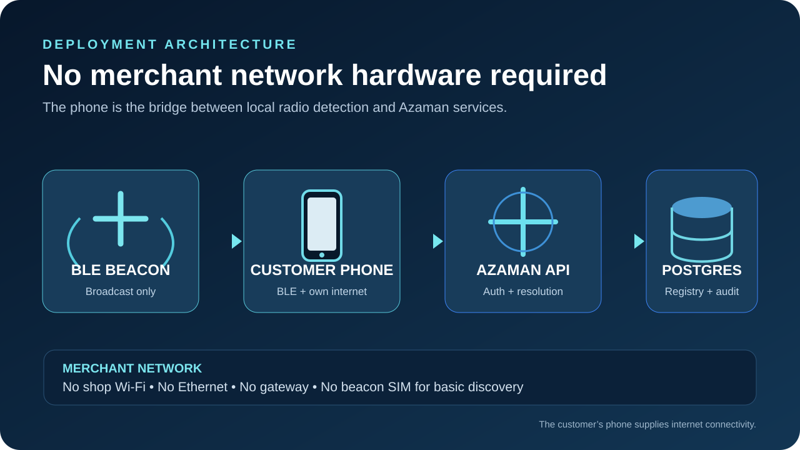
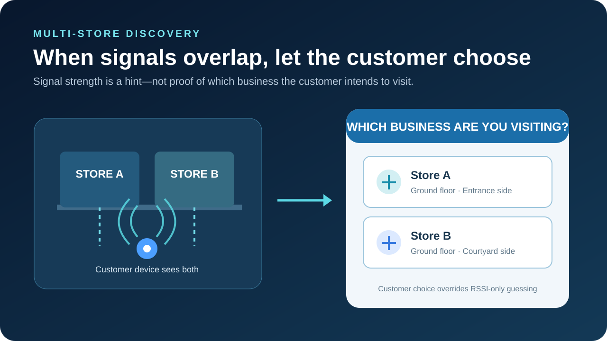
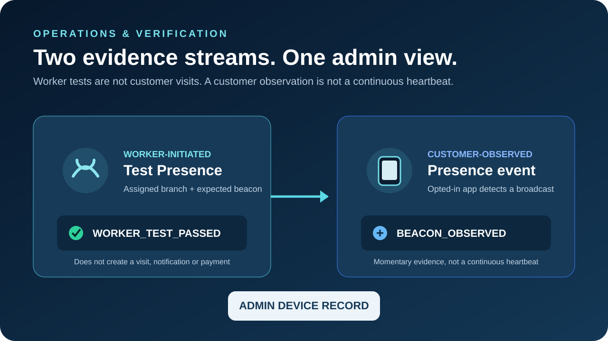
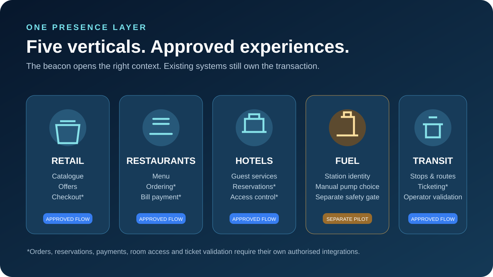
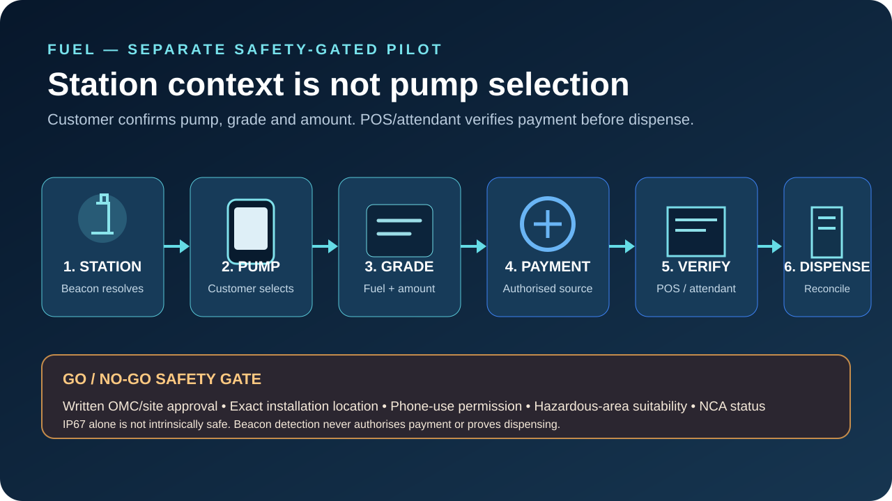

# Bluetooth Beacon — Azaman Presence

**Status:** Proposed initiative; controlled prototype recommended  
**Research reconciliation:** 7 November 2026  
**Stack:** Flutter · Node.js/Express · PostgreSQL/Prisma · Vite merchant portals

> This folder records product direction, research, hardware evaluation, technical architecture, privacy and safety constraints, rollout, open decisions and concept illustrations. It is a planning record—not implementation or supplier approval, legal advice, safety certification, financial approval or authorisation to deploy.

## Executive direction

Build a reusable physical-presence layer that allows Azaman to recognise a participating merchant branch or approved zone through a standalone Bluetooth Low Energy (BLE) beacon. An opted-in customer with Azaman installed detects the broadcast. The mobile app resolves the registered device through the authenticated Azaman backend and presents the merchant's approved marketplace experience.

The intended marketplace spans **retail, restaurants, hotels, fuel stations and transit**. A merchant may choose a payment-only/digital storefront or a richer catalogue/service experience, subject to capabilities already approved for that merchant and vertical.

The beacon broadcasts locally; it does not need shop Wi-Fi, Ethernet, a gateway or merchant SIM for the base interaction. The customer's phone uses its own internet connection to reach Azaman. Without a connected gateway or vendor management service, Azaman cannot claim continuous remote device health or battery telemetry.

## What it is—and is not

**It is:** contextual discovery into existing merchant and branch records; a shared proximity layer with approved vertical experiences; an easier way to find participating nearby businesses; an opt-in experience; and an operational network of registered devices, assignments, worker tests and customer-observed sessions.

**It is not:** precise indoor positioning, pump selection, gate authentication or room unlocking; a guarantee that every phone wakes in every OS state; proof of a shop visit, purchase or marketing consent; a substitute for merchant/POS/payment authority; a gateway-free way to monitor battery/online status; or evidence that phone use/BLE transmission is permitted in a fuel-station hazardous area.

## Concept illustrations

These vector concept illustrations are design aids—not engineering drawings, certified installation plans, compliance evidence or claims of implemented functionality.

### 1. Product overview

A standalone beacon identifies a participating location. The customer's phone uses its own data connection to reach the backend and load the approved storefront.

### 2. Deployment architecture

The beacon broadcasts locally; the customer's phone provides network connectivity. No merchant Wi-Fi, Ethernet or SIM is assumed in this base model.

### 3. Multiple nearby businesses

When adjacent or overlapping devices create ambiguity, Azaman asks the customer which business they are visiting rather than guessing from signal strength.

### 4. Operational verification

Worker tests and customer observations are separate evidence streams. A recent observation is not a continuous heartbeat.

### 5. Five marketplace verticals

One presence layer opens different merchant-approved experiences. Each vertical uses its own order, reservation, ticketing and payment authority.

### 6. Fuel workflow

The beacon identifies the approved station. The customer explicitly selects pump and confirms fuel/amount. Payment, attendant verification, dispensing and reconciliation remain separate. Safety approval precedes installation.

## Folder contents

| File | Purpose |
|---|---|
| [01 — Product direction](01_PRODUCT_DIRECTION.md) | Objective, principles and scope |
| [02 — Hardware and procurement](02_HARDWARE_AND_PROCUREMENT.md) | Supplier questions, candidate devices and Ghana equipment checks |
| [03 — Technical architecture](03_TECHNICAL_ARCHITECTURE.md) | Flutter, native BLE, Node.js, PostgreSQL and portal responsibilities |
| [04 — Security, privacy and data](04_SECURITY_PRIVACY_AND_DATA.md) | Spoofing, authentication, consent and minimisation |
| [05 — Mobile discovery and sessions](05_MOBILE_DISCOVERY_AND_SESSIONS.md) | Foreground/background, preferences, repeat visits and offline boundaries |
| [06 — Merchant portals and templates](06_MERCHANT_PORTAL_AND_TEMPLATES.md) | Vite configuration and safe feature schemas |
| [07 — Operations and administration](07_OPERATIONS_AND_ADMIN.md) | Worker tests, admin maps and analytics |
| [08 — Five vertical experiences](08_VERTICAL_EXPERIENCES.md) | Retail, restaurants, hotels, fuel and transit |
| [09 — Fuel station pilot](09_FUEL_STATION_PILOT.md) | Separate safety, operator, payment and reconciliation gates |
| [10 — Roadmap and acceptance](10_ROADMAP_AND_ACCEPTANCE.md) | Phases, test matrix and definition of done |
| [11 — Risks and open decisions](11_RISKS_AND_OPEN_DECISIONS.md) | Decisions implementation agents must not invent |
| [12 — Pitch narrative](12_PITCH_NARRATIVE.md) | Partner/investor narrative without overstating readiness |
| [References](REFERENCES.md) | Technical, supplier and Ghana reference links |
| [Assets](assets/README.md) | Illustration inventory and provenance |

## Recommended starting sequence

1. Read this README and the open-decision register.
2. Validate supplier documentation, exact product revisions, NCA type-approval status and provisioning/security capabilities.
3. Confirm product, privacy and merchant operating model before collecting customer presence data.
4. Prototype with a small number of devices in retail or restaurant settings—not fuel forecourts.
5. Prove Android and iOS behaviour, adjacent-store ambiguity, session deduplication and worker tests.
6. Integrate merchant portals and administration after the mobile/backend contract is stable.
7. Treat fuel as a separate OMC/site-safety pilot with explicit pump and POS/attendant integration.

## Approval boundaries

This package recommends a controlled prototype. It does **not** authorise bulk hardware purchasing, hazardous-area installation, live fuel payments, direct marketing, detailed customer movement histories, production schema changes, deployment or changes to Azaman financial flows. Those require separate documented approval and evidence.

The value is the verified physical merchant network and the approved experiences connected to it—not the beacon hardware by itself.
